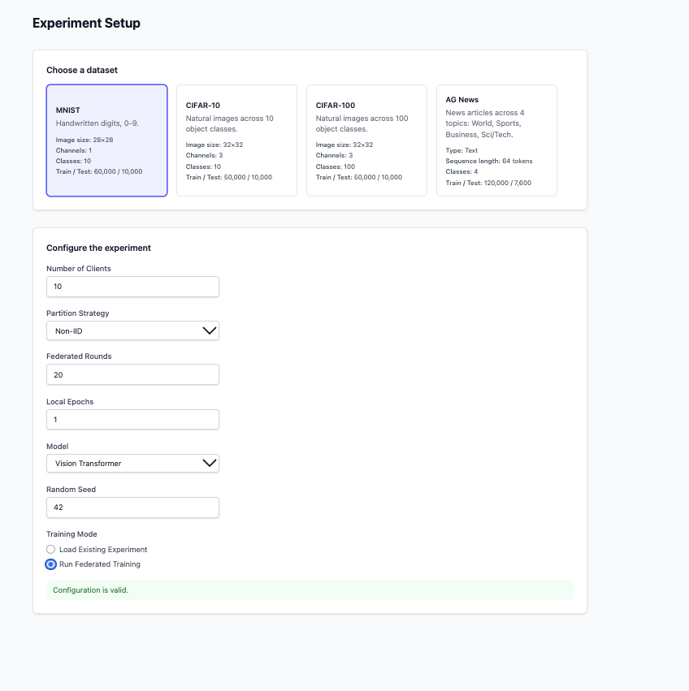
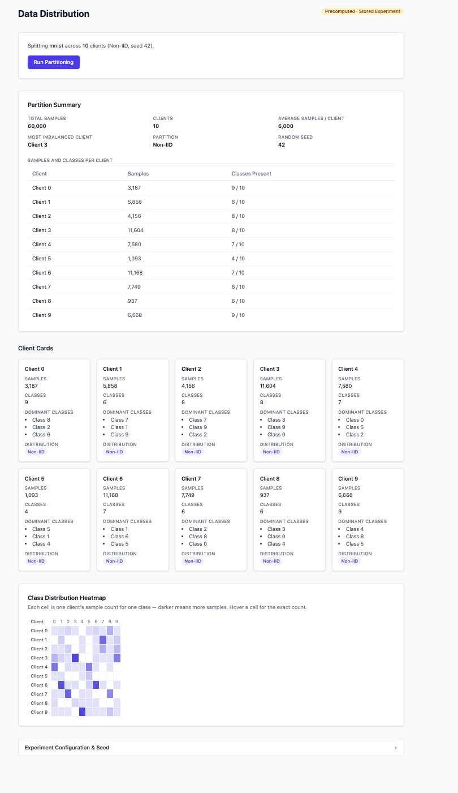
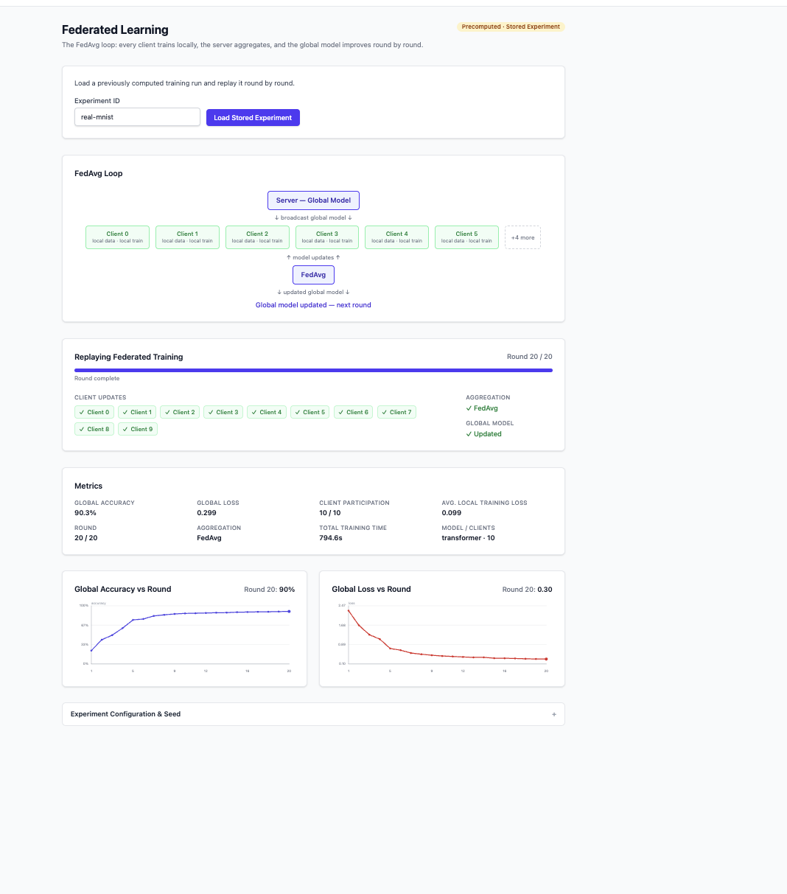
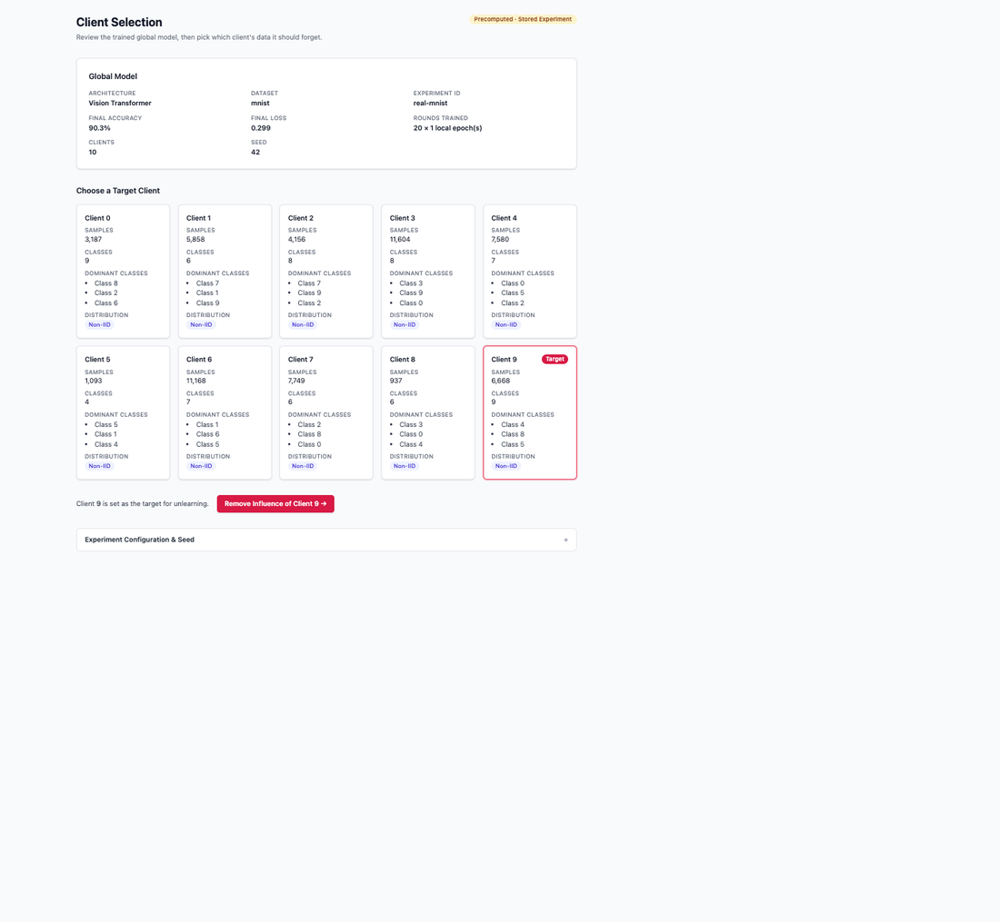
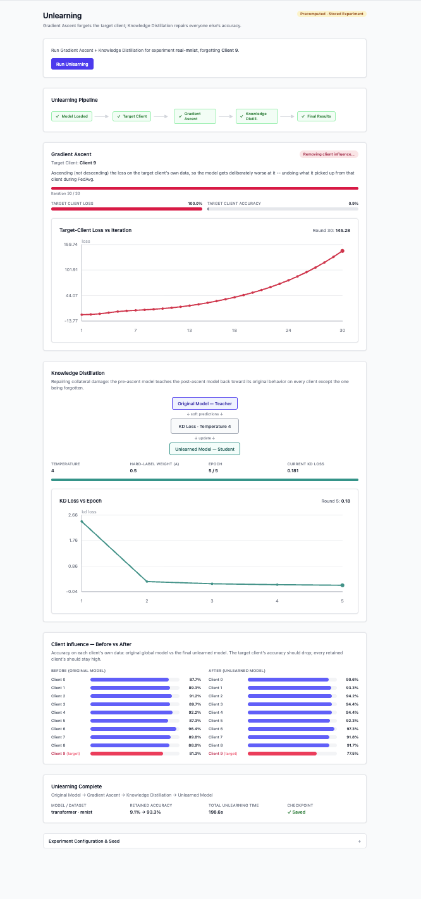
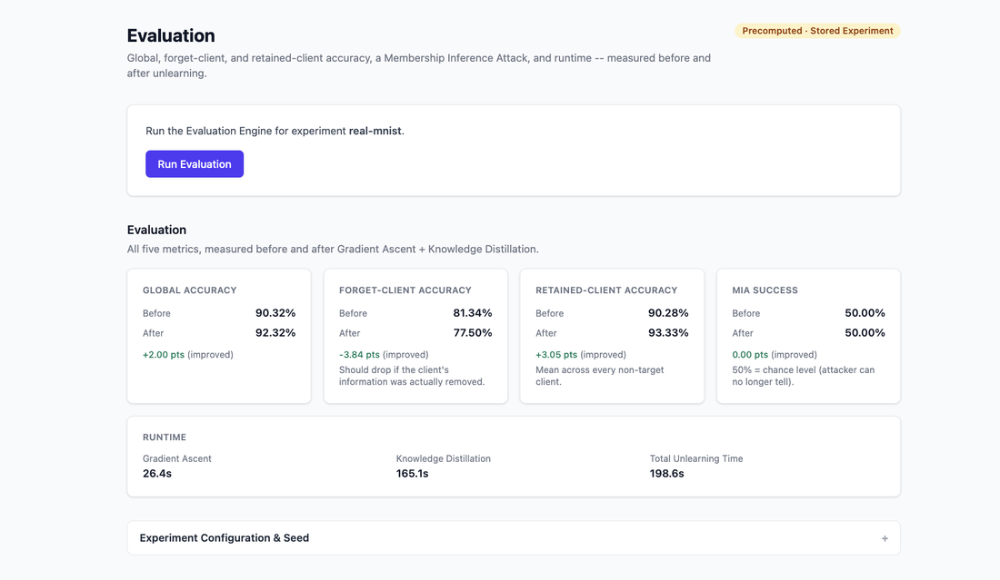
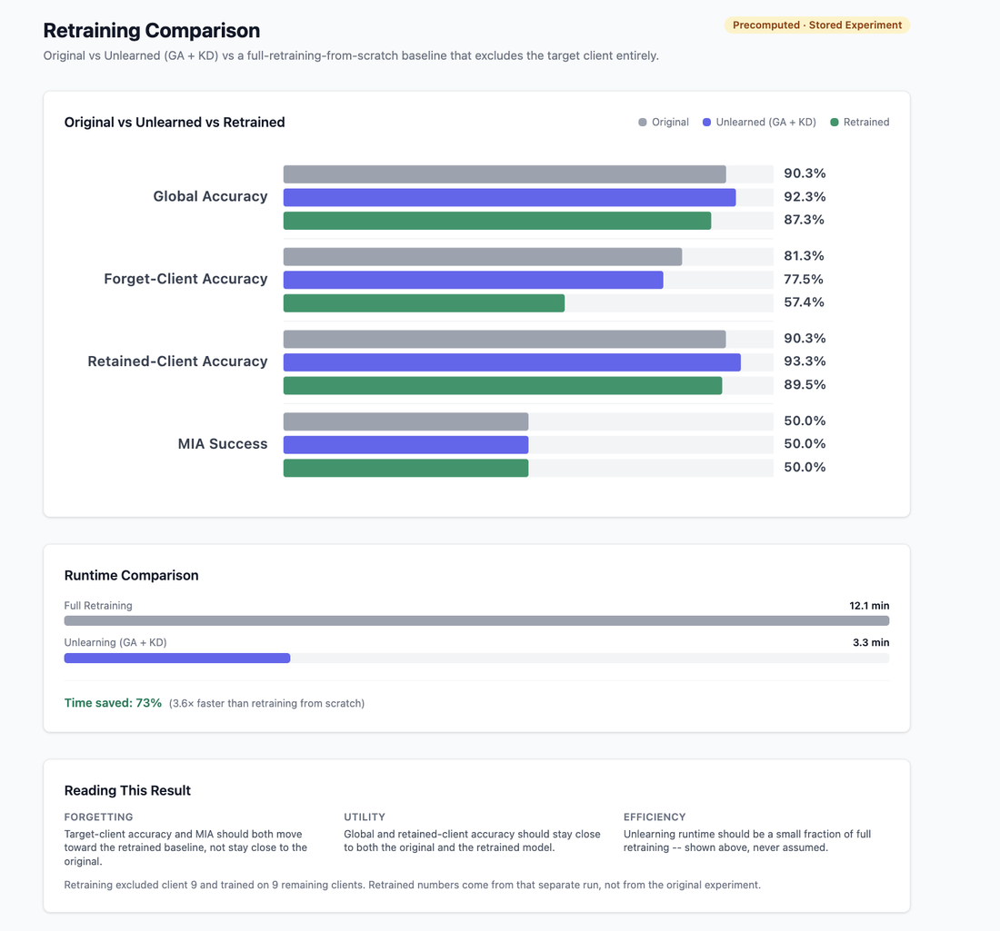
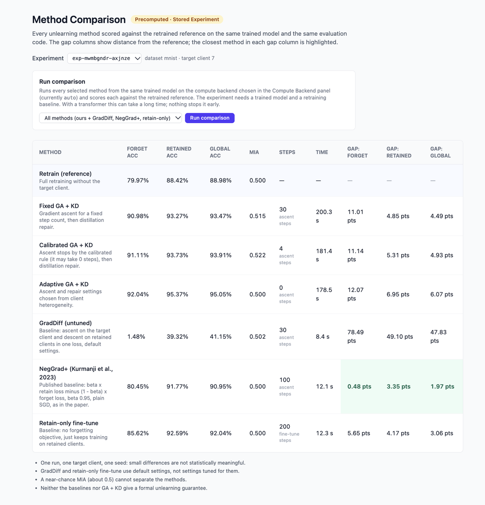
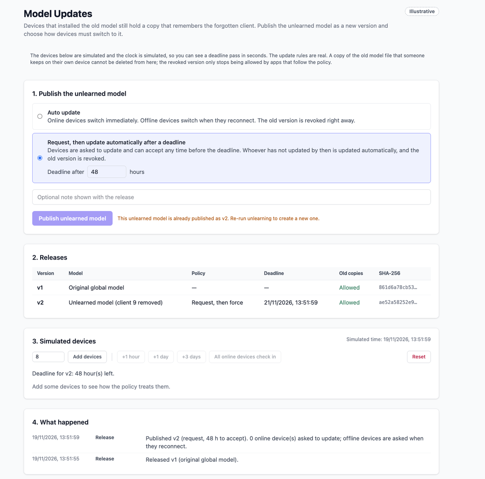

# Federated Unlearning Lab

An interactive lab for **client-level federated unlearning**. A dataset is split
across several federated clients, a global model is trained with FedAvg, one
client is chosen to be forgotten, and several unlearning methods try to remove
that client's influence. The lab then measures how well each one forgot, how much
accuracy the remaining clients kept, what a membership inference attack can still
tell, and how long it took, always against the honest reference: a model
retrained from scratch without that client.

**Status: complete.** The full pipeline, the dashboard, the method comparison,
remote GPU support, model updates and the demo mode are implemented. The
acceptance checklist is in [`docs/ACCEPTANCE_CHECKLIST.md`](./docs/ACCEPTANCE_CHECKLIST.md)
and can be run with `python -m core.acceptance.cli --all`; this README does not
claim that any particular stored experiment has passed it.

## What it does

```
Dataset -> Partition -> Federated training -> Global model -> Choose client to forget
        -> Unlearn -> Evaluate (accuracy, MIA, runtime) -> Compare with retraining
```

- **Datasets:** MNIST, CIFAR-10, CIFAR-100, AG News.
- **Models:** a small Vision Transformer for images, a small text transformer for text.
- **Partitions:** IID, or non-IID (Dirichlet) built from the dataset's real labels.
- **Everything is saved** in `experiments/<id>/`, so any finished experiment can be
  reopened, checked and replayed without recomputing it.

## Dashboard tour

The screenshots come from a stored `real-mnist` experiment: MNIST, 10 clients, Non-IID, 20 FedAvg rounds, forgetting Client 9. The Method Comparison screenshot is from a different stored experiment (target client 7).

### 1. Experiment Setup
Choose a dataset and the configuration, then train live or load a stored experiment.



### 2. Data Distribution
Samples and classes per client, client cards with dominant classes, and a class heatmap.



### 3. Federated Learning
The FedAvg loop, round-by-round client updates, and global accuracy and loss curves (90.3% accuracy after 20 rounds here).



### 4. Client Selection
Review the trained global model, then choose which client's data should be forgotten.



### 5. Unlearning
Gradient Ascent raises the loss on the target client's data; Knowledge Distillation then repairs the other clients. The page ends with a before and after accuracy bar for every client.



### 6. Evaluation
Global, forget-client and retained-client accuracy, MIA success and runtime, each before and after unlearning.



### 7. Retraining Comparison
Original vs unlearned vs a model retrained from scratch without the target client, plus the runtime difference (3.3 min vs 12.1 min in this run).



### 8. Method Comparison
Every unlearning method scored against the retrained reference on the same trained model.



### 9. Model Updates
Publish the unlearned model as a new version and choose how devices must switch. Devices and the clock are simulated.



## Unlearning methods

| Method | Kind |
|---|---|
| Gradient Ascent + Knowledge Distillation (fixed) | This project's main pipeline |
| Calibrated GA + KD | Opt-in calibrated stopping for the ascent |
| Adaptive GA + KD | Settings chosen from how distinctive the target client's data is |
| GradDiff (untuned) | Baseline |
| NegGrad+ (Kurmanji et al., 2023) | Published baseline |
| Retain-only fine-tune | Baseline |
| FedEraser (Liu et al., 2021) | Published method that replays recorded training rounds ([details](./docs/FEDERASER.md)) |
| Full retraining without the client | The reference every gap is measured against |

Measured results from one setup are in [`docs/results.md`](./docs/results.md).

## Quick start

You need Python 3.10+ with the packages in `core/requirements.txt` (this includes
PyTorch), and Node.js 18+.

1. Install Python packages: `pip install -r core/requirements.txt`
2. Install the backend: `cd backend && npm install`
3. Install the frontend: `cd frontend && npm install`
4. Start the backend (port 4000): `cd backend && npm start`
5. Start the frontend: `cd frontend && npm run dev`, then open the address it prints.
6. Run the tests: `python -m pytest tests -q`

To use other ports, start the backend with `PORT=<n>` and change the `/api` proxy
target in `frontend/vite.config.js` to match. Start the frontend with
`npm run dev -- --port <n>`.

Optional: copy `.env.example` to `.env` to configure remote GPU backends (see
[`docs/COMPUTE_BACKENDS.md`](./docs/COMPUTE_BACKENDS.md)). Without it, the app
runs on your own machine and uses CUDA automatically when PyTorch can see a GPU.
`COMPUTE_DEVICE` overrides the choice, and `CUDA_VISIBLE_DEVICES` picks the GPU.

## Use the dashboard

**Research mode.** Work down the left menu once: **Setup**, **Data Distribution**,
**Federated Learning**, **Client Selection**, **Unlearning Process**, **Results**,
**Retraining Comparison**, then **Method Comparison**. When all stages are done the
experiment shows as *Replayable* in **Experiment History**.

**Professor Demo.** Switch to Professor Demo (top of the left menu), choose a stored
experiment and press **START DEMO**. It replays the whole story in about 10 minutes
with a speaking guide on every page. It never trains or re-runs anything, so it
works with no GPU and no live backend. The talk track is in
[`docs/DEMO_SCRIPT.md`](./docs/DEMO_SCRIPT.md).

**Model updates.** After unlearning, publish the unlearned model as a new version
for devices that installed the old one (Auto update, or Request then update after a
deadline). Devices are simulated. See [`docs/MODEL_UPDATES.md`](./docs/MODEL_UPDATES.md).

## Run an experiment from the command line

`run_real_experiments.sh` and `run_real_label_eval.sh` run the whole pipeline on a
real dataset: partition from real labels, federated training, unlearning,
evaluation and the retraining baseline.

```
DEVICE=cuda ROUNDS=10 bash run_real_experiments.sh mnist
bash run_real_label_eval.sh cifar10 cifar10-real 0
```

Add the extra methods to the comparison afterwards:

```
python -m core.unlearning.compare_modes --experiment-id <id> --which all
python -m core.unlearning.federaser_cli --experiment-id <id> --device cuda
```

Run `compare_modes` first, because it rewrites `mode_comparison.json`; the FedEraser
command then adds its row to that file.

## How results are labelled

Every result screen shows one label, so you always know where a number came from.

| Label | Meaning |
|-------|---------|
| Measured | Computed by a real run in this session |
| Precomputed · Stored Experiment | Replayed from an earlier real run |
| Live | A run in progress right now |
| Illustrative | A diagram only, never a result |

Nothing is invented: an unfinished or unreadable stored result is refused with a
clear message instead of being drawn as if it were final.

## Reproducibility

Every result screen has a collapsible **Experiment Configuration & Seed** panel:
dataset, clients, partition, seed, model, rounds, local epochs, unlearning method and
hyperparameters, target client, and the software version (git commit). Values the
stored files do not contain are shown as "not recorded", never guessed. Older runs
do not have unlearning hyperparameters saved; re-run unlearning to record them.

## Checking an experiment

`python -m core.acceptance.cli --all` checks every stored experiment against the
machine-checkable parts of the acceptance checklist (complete files, consistent
numbers, measured runtimes, retraining really excluded the target). It needs no GPU
or torch. The full checklist, including the parts you check by eye, is in
[`docs/ACCEPTANCE_CHECKLIST.md`](./docs/ACCEPTANCE_CHECKLIST.md).

## When something fails

Failures show what failed, which stage, and what to do next (Retry, Run Training,
Select Another Experiment, and so on). The technical error is under "Technical
details". Engine runs have no time limit by default; to add one, set
`ENGINE_TIMEOUT_MS` (milliseconds) in `backend/.env`. Set `PYTHON_BIN` if your
Python is not called `python3`.

## Repository layout

```
frontend/     React (Vite) dashboard: UI only, no ML logic
backend/      Node/Express API: routes requests to a ComputeBackend
core/         Python engine: datasets, partitioning, federated, unlearning, evaluation, compute
tests/        pytest suite
docs/         Specification, architecture, results, guides
colab/        Notebook for running the compute server on Google Colab
dashboard/    Early standalone prototype with a simulated engine (numbers are modeled, not trained)
experiments/  Generated experiment files (contents are not committed)
```

Where each feature lives in the code: [`docs/CODE_MAP.md`](./docs/CODE_MAP.md).

## Documentation

| Document | What it covers |
|---|---|
| [Architecture document](https://unknown183-a.github.io/federated-unlearning-v2/Federated-Unlearning-Lab-Architecture.html) | The 26-chapter system design, as a web page |
| [`docs/FEDERATED_UNLEARNING_DASHBOARD_SPEC_V2.md`](./docs/FEDERATED_UNLEARNING_DASHBOARD_SPEC_V2.md) | The full product specification (Markdown) |
| [`docs/CODE_MAP.md`](./docs/CODE_MAP.md) | Where each part of the project lives |
| [`docs/results.md`](./docs/results.md) | Measured method comparison and its limitations |
| [`docs/algorithm_history.md`](./docs/algorithm_history.md) | Gradient Ascent + KD algorithm versions and how to revert |
| [`docs/FEDERASER.md`](./docs/FEDERASER.md) | The FedEraser method, how to run it, its limits |
| [`docs/RESEARCH_EXTENSION.md`](./docs/RESEARCH_EXTENSION.md) | The heterogeneity-aware adaptive unlearning proposal and what is implemented |
| [`docs/COMPUTE_BACKENDS.md`](./docs/COMPUTE_BACKENDS.md), [`docs/REMOTE_COMPUTE_SETUP.md`](./docs/REMOTE_COMPUTE_SETUP.md) | Local, remote GPU and Colab backends |
| [`docs/MODEL_UPDATES.md`](./docs/MODEL_UPDATES.md) | Publishing unlearned models to devices |
| [`docs/DEMO_SCRIPT.md`](./docs/DEMO_SCRIPT.md), [`docs/ACCEPTANCE_CHECKLIST.md`](./docs/ACCEPTANCE_CHECKLIST.md) | Presenting the project, and checking it |
| [`CONTRIBUTING.md`](./CONTRIBUTING.md) | Conventions for changing the code |

## Limitations

- Results so far come from one seed and small models, mostly MNIST. Differences under
  about one point should not be read as real. See the limitations in `docs/results.md`.
- On a label-skewed MNIST split, NegGrad+ matched the retrained reference on forget
  accuracy, while the Gradient Ascent + Distillation modes kept utility but forgot
  less. No result here shows the adaptive method beating the fixed one.
- FedEraser's default settings are untuned and gave low retained accuracy in a first
  MNIST run; it also needs the per-round client updates recorded during training.
- The membership inference attack uses a small non-member sample, so values near 0.5
  are weak evidence.
- No formal or certified unlearning guarantee is claimed. Retraining without the
  client is a reference, not a proof.
- Model-update devices are simulated.
